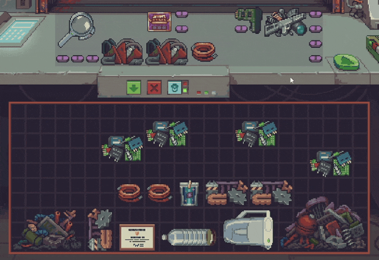
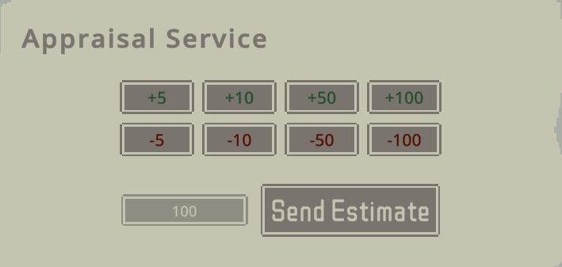
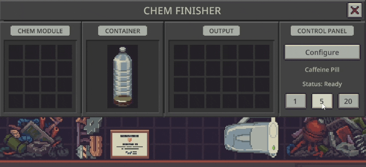

# Tuck

Love [Probably Stolen](https://store.steampowered.com/app/4348910/Probably_Stolen_Cyberpunk_Shopkeeper_Sim/), but tired of the repetitive clicking? Give your hands a break with Tuck, your one-stop quality-of-life mod.

Pack your loot, move items in bulk, appraise goods, and run the chem finisher with fewer clicks and less fuss. You've got a shop to run.

Named after Tuck, the helpful rat who fits more loot into your bags. Small paws, big ambitions.

## Feature overview

| Activity | Improvements |
| --- | --- |
| [Item manipulation](#item-manipulation) | Drag matching items or an entire inventory, keep items in formation, and swap installed filters. |
| [Night activities](#night-activities) | Pack with Tuck, configurable hotkeys, and adjustable return hold time and scavenging warnings. |
| [Appraisal](#appraisal) | ±50 adjustment buttons and automatic disposal of appraisal slips. |
| [Chem finisher](#chem-finisher) | Batch printing and protection against wasted ingredients when output cannot be placed. |
| [Shopkeeping](#shopkeeping) | Configurable shutter and night activity menu hotkeys, centered backpack selection, adjustable bell hold time and workspace warnings, and automatic disposal of event receipts. |

## Features

### Item manipulation

- Adds a configurable modifier to drag all matching items (default: Shift).
  Holding it while dragging one item selects all items of that kind; while dragging multiple items, it selects all items of those kinds.
- Adds a configurable modifier to drag all draggable items in the inventory (default: Ctrl), including when starting from empty space.
- Releasing Shift or Ctrl restores the original drag or resumes box selection.
- Makes the preserve-placement modifier configurable (default: Alt, replacing the vanilla Shift modifier).
- Adds an option to swap filters by dragging a new filter onto the installed filter in an open filter slot, on by default.
  The removed filter must fit in the replacement's original space.

### Night activities

- Adds a configurable hotkey to Pack (default: G). Tuck the rat helps you pack the most value into your bags before leaving. You can also click Tuck to Pack.
- Adds a configurable hotkey to Scavenge (default: Space).
- Adds a configurable hotkey to return from a night activity (default: R), activated by holding and releasing it.
  The hold time defaults to 0.4 seconds, adjustable from 0.0 to 1.0 seconds. Set it to 0.0 to return on key press.
- Adds an option to specify a minimum value of items left behind before the "Items left behind will be lost" dialog shows up when returning from scavenging.
  The default is 50 credits. Set it to 0 credits for vanilla behavior, or 1000 credits to disable the warning entirely.

### Appraisal

- Adds optional ±50 buttons and arranges the ±5, ±10, ±50 and ±100 buttons in two rows above the estimate and send button, off by default.
- Adds an option to automatically move newly received appraisal slips to the trash, off by default.

### Chem finisher

- Adds optional 1, 5 and 20 batch buttons, off by default.
  Also avoids the vanilla bug where printing consumes ingredients even if it fails to place the output.

### Shopkeeping

- Adds a configurable hotkey to open/close the shutters (default: C).
- Adds a configurable hotkey to open night activities (default: Q).
  Adds an option to center the backpack selection menu, off by default.
- Adds a configurable hold time for ringing the bell, defaulting to 0.4 seconds, adjustable from 0.0 to 1.0 seconds.
  Set it to 0.0 for no hold. The bell still respects the vanilla instant next customer setting.
- Adds an option to specify how much of the workspace can be occupied before the "keep your counter clear" warning shows up when going outside.
  The default is 40%. Set it to 0% for vanilla behavior, or 100% to disable the warning entirely.
- Adds an option to automatically move newly received event receipts to the trash, off by default.

## Principles

These are the principles that govern the development of Tuck.

### No unfair advantage

Tuck does not give you an unfair advantage in your gameplay.
All it does is improve your interactions with the game.

### Compatibility

Tuck aims to work well alongside other mods.
Optional features can be disabled individually, so an incompatibility between one of your other mods and one of Tuck's features doesn't prevent you from using the other features.

### Security

Tuck's [source code](https://github.com/mickvangelderen/tuck) is available for anyone to inspect.
You can also decompile the mod with [ILSpy](https://ilspy.net/) to examine what it does.

### One quality of life mod

Tuck strives to be the only quality of life mod you need.
By bundling good ideas and contributions into one actively developed mod, we can:
- design and test the features together, ensuring compatibility;
- audit the security of a single mod rather than reviewing many or trusting many different authors;

## Limitations

The Probably Stolen game and modding architecture imposes some limitations on what this mod can reasonably achieve.
These limitations are described here along with their workarounds if available.

### Keybindings

Probably Stolen doesn't allow conflicting keybindings, even when they are used in different contexts.
To work around this, go to the mod's settings from the main menu, and type in the keybinding as a string.

### Compatibility

Probably Stolen's data model is very flexible.
The game and mod authors can run *any* code when interacting with items.

For example, the screwdriver opens a ruined module and salvages some items.
This interaction is not an explicitly modeled behavior that is re-used.
This makes it difficult for Tuck to predict accurately what will happen for items that mods might add.

Tuck values ruined modules based on their would-be salvaged components.
However, it cannot do this generically for every item and interaction that may be added.
Some other features have similar hardcoded assumptions about the vanilla codebase.
Support for popular mods can be added as needed, please do let us know!

Regardless, even if Tuck may not pack "optimally", he will still help and save you work!

## Alternatives

Others had similar ideas, here are some:

- [Quick Pickup](https://steamcommunity.com/sharedfiles/filedetails/?id=3832375203)
- [Night Haul](https://steamcommunity.com/sharedfiles/filedetails/?id=3828895201)

## Contributions

Feel free to contribute ideas and improvements.

## Licensing

Tuck is licensed under the [MIT License](LICENSE).
You may use, modify, and share it provided you retain the copyright and license notice.
