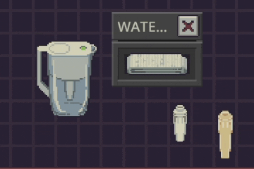
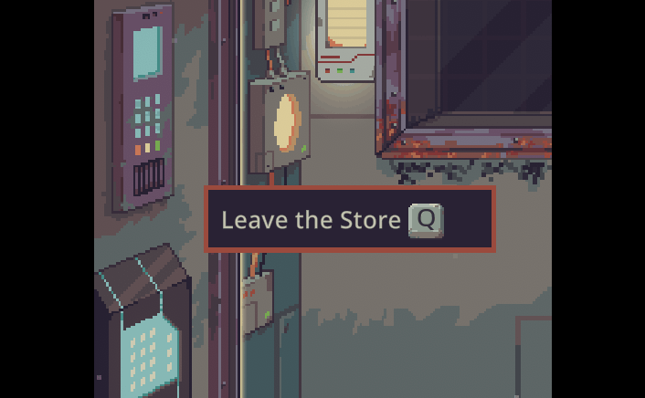

# Tuck

Love [Probably Stolen](https://store.steampowered.com/app/4348910/Probably_Stolen_Cyberpunk_Shopkeeper_Sim/), but tired of the repetitive clicking? Give your hands a break with Tuck, your one-stop quality-of-life mod.

Pack your loot, move items in bulk, appraise goods, and run the chem finisher with fewer clicks and less fuss. You've got a shop to run.

Named after Tuck, the helpful rat who fits more loot into your bags. Small paws, big ambitions.

## Features

The highlights:

### Better item manipulation

Move all of kind (Alt + drag), move all of inventory (Ctrl + drag). 

### Quick swap water filter

### Better appraisal UI

Adds +50 and -50, rearranges for convenience.

### Auto open appraisal guides

Opens relevant guides and color swatches when appraising an item. Closes them together too.

### Print multiple items with Chem finisher

Adds +5 and +20 output buttons.

### More hotkeys

Hotkeys for vanilla and mod interactions! Hotkeys are shown in tooltips, and configurable.

## Principles

These are the principles that govern the development of Tuck.

### No unfair advantage

Tuck does not give you an unfair advantage in your gameplay.
All it does is improve your interactions with the game.

### Compatibility

Tuck aims to work well alongside other mods.
Optional features can be disabled individually, so an incompatibility between one of your other mods and one of Tuck's features doesn't prevent you from using the other features.

### Security

Tuck's [source code](https://github.com/mickvangelderen/tuck) is available for anyone to inspect.
You can also decompile the mod with [ILSpy](https://ilspy.net/) to examine what it does.

### One quality of life mod

Tuck strives to be the only quality of life mod you need.
By bundling good ideas and contributions into one actively developed mod, we can:
- design and test the features together, ensuring compatibility;
- audit the security of a single mod rather than reviewing many or trusting many different authors;

## Limitations

The Probably Stolen game and modding architecture imposes some limitations on what this mod can reasonably achieve.
These limitations are described here along with their workarounds if available.

### Keybindings

Probably Stolen doesn't allow conflicting keybindings, even when they are used in different contexts.
To work around this, go to the mod's settings from the main menu, and type in the keybinding as a string.

### Compatibility

Probably Stolen's data model is very flexible.
The game and mod authors can run *any* code when interacting with items.

For example, the screwdriver opens a ruined module and salvages some items.
This interaction is not an explicitly modeled behavior that is re-used.
This makes it difficult for Tuck to predict accurately what will happen for items that mods might add.

Tuck values ruined modules based on their would-be salvaged components.
However, it cannot do this generically for every item and interaction that may be added.
Some other features have similar hardcoded assumptions about the vanilla codebase.
Support for popular mods can be added as needed, please do let us know!

Regardless, even if Tuck may not pack "optimally", he will still help and save you work!

## Alternatives

Others had similar ideas, here are some:

- [Quick Pickup](https://steamcommunity.com/sharedfiles/filedetails/?id=3832375203)
- [Night Haul](https://steamcommunity.com/sharedfiles/filedetails/?id=3828895201)

## Contributions

Feel free to contribute ideas and improvements.

## Licensing

Tuck is licensed under the [MIT License](LICENSE).
You may use, modify, and share it provided you retain the copyright and license notice.
